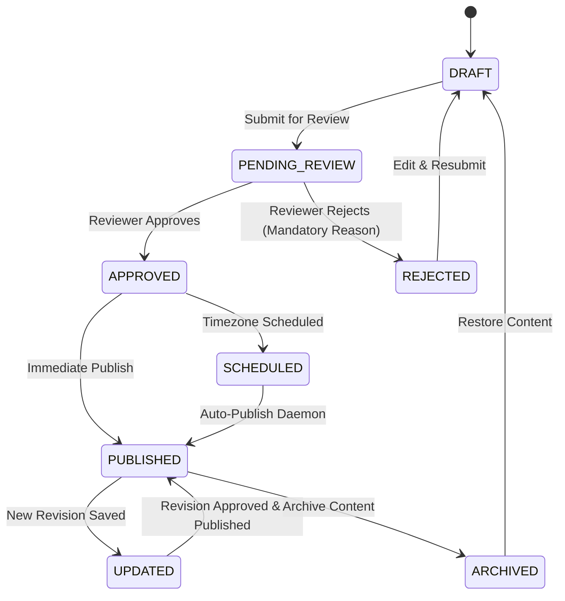

# KDW Content Management System — Master Implementation Plan

> **Phase 0 — Requirement Discovery & Comprehensive Architecture Plan**  
> System: **Kanishk Digital World (KDW) Ecommerce & Digital Product Delivery Platform**

---

## 1. Executive Architecture Inspection

### Frontend Architecture
- **Framework & Tooling**: React 18, TypeScript, Vite 8, Tailwind CSS, Lucide React icons, React Router DOM v6.
- **Styling & Theme**: Modern navy/blue admin palette, rounded cards (`rounded-2xl`), border slate-200, status pills, responsive tables with horizontal scroll and mobile collapse.
- **State Management & Authentication**: `AuthContext.tsx` with JWT cookies/Bearer headers, `useStore.ts` Zustand store for global cart/notifications.

### Backend Architecture
- **Framework**: Express 5 on Node.js / TypeScript, port 5000.
- **Database ORM**: PostgreSQL 16 on port 5432 (`kwd_db`), Prisma Client v5.22.0.
- **Authentication & Security**: JWT verification in `authMiddleware.ts`, role-based authorization (`authorize(...)` with `SUPER_ADMIN`, `ADMIN`, `STORE_MANAGER`, `STAFF`, `ANALYST`, `CONTENT_EDITOR`, `REVIEW_MODERATOR`), CSRF protection.
- **Audit & Telemetry**: Immutable audit log records with actor, IP, timestamp, previous vs new states, and mandatory reasons.

---

## 2. Existing Content-Related Functionality vs Needs

| Feature Area | Current Status in Codebase | Required Enhancements in Content Module |
|---|---|---|
| **Pages** | Hardcoded storefront pages | Full DB-backed Pages with structured Block Editor, templates, lifecycle, revisions, policy publishing compliance, and SEO. |
| **Blogs** | Basic `Blog` model with simple text | Full `BlogPost` model, block editor, categories, tags, authors, related product linking & purchase attribution, reading time, SEO. |
| **FAQs** | Simple `FAQ` model in `supportController` | Full `ContentFaq` with Scopes (Global, Product, Category, Campaign), duplicate question detection, versioning, expiry, structured data. |
| **Banners** | Simple `HeroBanner` model | Full `ContentBanner` with 9 Placements, deterministic priority resolution, start/end scheduling, auto-expiry, audience targeting, attribution analytics. |
| **Customer Feedback** | Mixed between Support & Reviews | Comprehensive `CustomerFeedback` classifying Bug, Feature, Download, Licence, Review with assignment, priority override, separation of private support from public reviews, review conversion. |
| **Media Library** | Simple local upload / Drive link | Centralized Media Library with metadata, alt text enforcement, responsive dimensions, and **zero-accidental-deletion safety** (blocks deleting in-use media). |
| **Navigation & Menus** | Static sidebar & header links | Dynamic `NavigationMenu` builder for Header, Footer columns, and Mobile drawer. |
| **Redirects** | Simple CategoryRedirect model | Complete `ContentRedirect` engine with automated 301 creation on slug change, loop detection, and conflict prevention. |
| **Revisions** | Partial ReviewRevision | Universal `ContentRevision` preserving complete historical snapshots, authors, diffs, and instant rollback. |
| **Approval & Schedule** | None | Centralized `ApprovalQueue` with mandatory rejection reasons and timezone-aware `ScheduledContent` auto-publisher. |
| **Content Analytics** | General Analytics only | Dedicated Content Analytics measuring Views, Engagement, CTR, Product Clicks, Add-to-Cart, and Revenue Attribution without double counting. |

---

## 3. Complete Content Admin Navigation (16 Core Modules)

```text
Content Management
├── 1. Overview (/admin/content/overview)
├── 2. Pages (/admin/content/pages)
├── 3. Blogs (/admin/content/blogs)
├── 4. FAQs (/admin/content/faqs)
├── 5. Banners (/admin/content/banners)
├── 6. Customer Feedback (/admin/content/feedback)
├── 7. Media Library (/admin/content/media)
├── 8. Navigation Menus (/admin/content/navigation)
├── 9. Redirects (/admin/content/redirects)
├── 10. SEO Settings (/admin/content/seo)
├── 11. Content Templates (/admin/content/templates)
├── 12. Drafts (/admin/content/drafts)
├── 13. Scheduled Content (/admin/content/scheduled)
├── 14. Approval Queue (/admin/content/approval-queue)
├── 15. Revisions (/admin/content/revisions)
└── 16. Content Analytics (/admin/content/analytics)
```

---

## 4. Universal Content Lifecycle & State Machine



---

## 5. Database Schema Extensions (Prisma ORM)

Models to add or extend in `server/prisma/schema.prisma`:

1. **`ContentPage`**: Page title, slug, summary, `contentJson` (Block Editor), template, status, authorId, reviewerId, rejectionReason, featuredImage, policy metadata, SEO fields, scheduledAt, publishedAt.
2. **`BlogPost`**: Title, slug, excerpt, `contentJson`, authorId, categoryId, tags, coverImage, readingTimeMinutes, status, scheduledAt, publishedAt, relatedProductIds, relatedCategoryIds, SEO fields, analytics counters.
3. **`BlogCategory`**: Category name, slug, description, displayOrder, status.
4. **`BlogTag`**: Tag name, slug, color.
5. **`BlogAuthor`**: Name, slug, avatar, bio, roleTitle, socialLinks.
6. **`ContentFaq`**: Question, answer, scopeType (`GLOBAL`, `PRODUCT`, `CATEGORY`, `CAMPAIGN`), productId, categoryId, displayOrder, status, isOutdated, outdatedReason, expiresAt, helpful/unhelpful votes.
7. **`ContentBanner`**: Name, placement (9 slots), desktopImage, mobileImage, altText, headline, supportingText, ctaLabel, ctaUrl, productId, categoryId, priority, audience, status, startAt, endAt, impressions, clicks, conversions, revenueAttributed.
8. **`CustomerFeedback`**: CustomerId, orderId, productId, productVersionId, feedbackType, rating, title, message, attachmentUrl, status, priority, priorityOverrideReason, assignedToId, assignedToName, isPublicReview, moderationStatus, internalNotes.
9. **`ContentRevision`**: ContentType (`PAGE`, `BLOG`, `FAQ`, `POLICY`, `TEMPLATE`), contentId, versionNumber, `contentSnapshot`, changedById, changedByName, changeSummary, publishedAt.
10. **`ContentRedirect`**: OldPath, newPath, redirectType (`301`, `302`), reason, status, hitsCount, createdById.
11. **`ContentTemplate`**: Name, slug, contentType, `layoutJson`, isDefault, status.
12. **`MediaAsset`**: FileName, originalName, fileType, mimeType, fileSize, dimensions, url, altText, caption, folder, usageReferences, isUsed.
13. **`NavigationMenu`**: Name, slug, location, `itemsJson`, status.

---

## 6. Backend API Route Structure

All endpoints mounted under `/api/admin/content/*` and protected by `authenticate` and `authorize`:

- **Overview**: `GET /api/admin/content/overview`, `GET /api/admin/content/health-alerts`
- **Pages**: `GET /api/admin/content/pages`, `POST /api/admin/content/pages`, `GET /api/admin/content/pages/:id`, `PATCH /api/admin/content/pages/:id`, `POST /api/admin/content/pages/:id/submit-review`, `POST /api/admin/content/pages/:id/publish`, `POST /api/admin/content/pages/:id/schedule`, `POST /api/admin/content/pages/:id/archive`
- **Blogs**: `GET /api/admin/content/blogs`, `POST /api/admin/content/blogs`, `PATCH /api/admin/content/blogs/:id`, `GET /api/admin/content/blogs/categories`, `POST /api/admin/content/blogs/categories`, `GET /api/admin/content/blogs/tags`, `GET /api/admin/content/blogs/authors`
- **FAQs**: `GET /api/admin/content/faqs`, `POST /api/admin/content/faqs`, `PATCH /api/admin/content/faqs/:id`, `POST /api/admin/content/faqs/:id/mark-outdated`
- **Banners**: `GET /api/admin/content/banners`, `POST /api/admin/content/banners`, `PATCH /api/admin/content/banners/:id`, `POST /api/admin/content/banners/:id/activate`, `POST /api/admin/content/banners/:id/pause`
- **Feedback**: `GET /api/admin/content/feedback`, `GET /api/admin/content/feedback/:id`, `POST /api/admin/content/feedback/:id/assign`, `POST /api/admin/content/feedback/:id/resolve`, `POST /api/admin/content/feedback/:id/moderate-review`
- **Media Library**: `GET /api/admin/content/media`, `POST /api/admin/content/media/upload`, `PATCH /api/admin/content/media/:id`, `DELETE /api/admin/content/media/:id` (with usage verification)
- **Redirects**: `GET /api/admin/content/redirects`, `POST /api/admin/content/redirects`, `PATCH /api/admin/content/redirects/:id`, `DELETE /api/admin/content/redirects/:id`
- **SEO & Structured Data**: `GET /api/admin/content/seo/audit`, `POST /api/admin/content/seo/validate`
- **Approval Queue**: `GET /api/admin/content/approval-queue`, `POST /api/admin/content/approval-queue/:id/approve`, `POST /api/admin/content/approval-queue/:id/reject`
- **Revisions**: `GET /api/admin/content/revisions`, `POST /api/admin/content/revisions/:id/restore`
- **Analytics**: `GET /api/admin/content/analytics`
- **Public Storefront APIs**: `GET /api/content/pages/:slug`, `GET /api/content/blogs`, `GET /api/content/blogs/:slug`, `GET /api/content/faqs`, `GET /api/content/banners/placement/:placement`, `GET /api/content/navigation/:location`, `GET /api/content/redirects/resolve`

---

## 7. Verification & Testing Strategy

1. **Prisma Database Sync**: Update schema, run `npx prisma db push` and `npx prisma generate`.
2. **Master Seeder**: Populate realistic pages, blogs, FAQs, banners, feedback, revisions, redirects, media assets, and templates.
3. **Automated Integration Test Suite**: Write and run `verify_content_module.ts` querying all 16 modules, testing state transitions, role permissions, block validations, media usage blocks, and slug redirects.
4. **Production Build Verification**: Run `npm run build` on both `server` and `front end` verifying clean compilation.
5. **Final Audit**: Generate `CONTENT_IMPLEMENTATION_AUDIT.md` verifying every feature as 100% functional.
